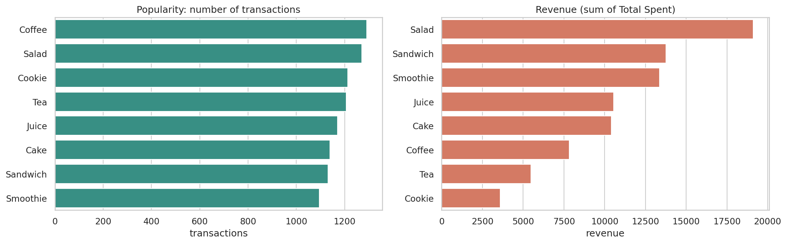

# Cafe Sales EDA: What Drives Revenue? (and What Doesn't)

> DecodeLabs Data Analytics, Project 2 (Exploratory Data Analysis) | Tools: Python, pandas, seaborn, scipy, Jupyter
> Builds on [Project 1: Cafe Sales Data Cleaning](../project-1-data-cleaning)

## The question

A cafe owner has a year of sales (10,000 transactions) and wants answers before investing in dashboards or forecasts:

1. Which items drive revenue?
2. Do in-store and takeaway customers behave differently?
3. Are there seasonal or weekday patterns?
4. Are there unusual values that need attention?

## The data

The audited, cleaned dataset from Project 1: 10,000 transactions, 0 duplicate IDs, all dates in `YYYY-MM-DD`. Source: [*Cafe Sales - Dirty Data for Cleaning Training*](https://www.kaggle.com/datasets/ahmedmohamed2003/cafe-sales-dirty-data-for-cleaning-training) on Kaggle (a practice dataset for a fictional cafe). Check the dataset page for its licence and terms of use.

Gaps that could not be reliably filled were left in place, so each question uses only the rows it can trust:

| Gap | Rows | How it is handled |
|---|---|---|
| Missing date | 460 | Excluded from trend analysis |
| Unknown location | 3,961 (40%) | Excluded from the in-store vs takeaway comparison |
| Unknown payment method | 3,178 (32%) | Excluded from the payment comparison |
| Unknown item | 480 | Excluded from item comparisons |

## Approach

1. Load and quality-check the data, then define the usable subset for each question.
2. Descriptive statistics: count, mean, median, standard deviation, skewness, five-number summary.
3. Distributions: check the shape of every numeric column.
4. Outliers: IQR and Z-score methods side by side, then decide whether each outlier is noise or signal.
5. Category comparisons: items, location, payment method, using Mann-Whitney and Kruskal-Wallis tests because order values are right-skewed.
6. Trends: monthly and weekday patterns, normalised per day (so February doesn't look weak just for being shorter).
7. Correlation analysis, with the caveat that Total Spent = Quantity x Price.
8. Translate the numbers into business observations (the "So what?" test).

## Key findings

| Finding | Evidence |
|---|---|
| **Revenue is driven by price, not popularity** | Salad earns the most ($19,125, 22.7% of known-item revenue). Coffee sells most often (1,291 transactions) but ranks sixth on revenue. Transactions per item range only 1,096 to 1,291. Unit price vs item revenue correlation: 0.99; transactions vs revenue: -0.11 |
| **Order values are right-skewed** | Mean $8.93 vs median $8.00 (skewness 0.82), so the median describes a typical order better |
| **The "outliers" are real big orders** | The IQR rule flags 269 orders, the Z-score rule flags 0. 268 of the 269 are Salad x 5, the largest possible order, so they were kept as signal. The remaining one is an incomplete record from Project 1, flagged for review |
| **In-store and takeaway behave alike** | Average order $9.04 vs $8.81, Mann-Whitney p = 0.14 |
| **Payment method makes no difference** | Kruskal-Wallis p = 0.77 |
| **No strong seasonality or weekday effect** | Monthly revenue per day varies by 2.7%; weekdays differ by at most 1.06x |



## What this means for the business

- Revenue differences come from price, so test bundles or add-ons for low-priced items (Cookie, Tea) that sell as often as the leaders but earn far less.
- Don't clean away the big orders; they are legitimate and valuable.
- The data does not support separate strategies by location, payment method, month or weekday.
- The weakest fields are location, payment method, item and date. Capturing them reliably would give the biggest improvement to the next analysis.

## Limitations

- This is a practice dataset with near-uniform patterns, so the result is a demonstration of method, not a real business outcome.
- The data has no cost information, so revenue is not profit.
- Correlation is not causation: the price finding shows association, and promotions or pricing changes would need a controlled test.
- Location conclusions rest on the 60% of rows with a known location and are indicative only.

## Files

| File | What it is |
|---|---|
| `cafe_sales_eda.ipynb` | The full notebook with code, outputs and commentary |
| `cafe_sales_clean.csv` | Input: the cleaned dataset from Project 1 |
| `key_observations.txt` | The notebook's generated findings summary |
| `requirements.txt` | Python packages needed |
| `cafe_sales_eda_executive_summary.pdf` | Two-page executive summary |
| `figures/` | The 7 charts produced by the notebook |
| `tables/` | Summary tables (item summary, monthly trend, outlier summary, descriptive stats) |

## How to run

```bash
pip install -r requirements.txt
jupyter notebook cafe_sales_eda.ipynb
```

Keep `cafe_sales_clean.csv` in the same folder as the notebook, then run all cells. The notebook creates the `figures/` and `tables/` folders.

## Skills demonstrated

Exploratory data analysis, descriptive statistics, outlier detection (IQR vs Z-score), non-parametric hypothesis testing, time-trend analysis, correlation analysis, data visualisation with seaborn and matplotlib, and communicating findings to a non-technical audience.
